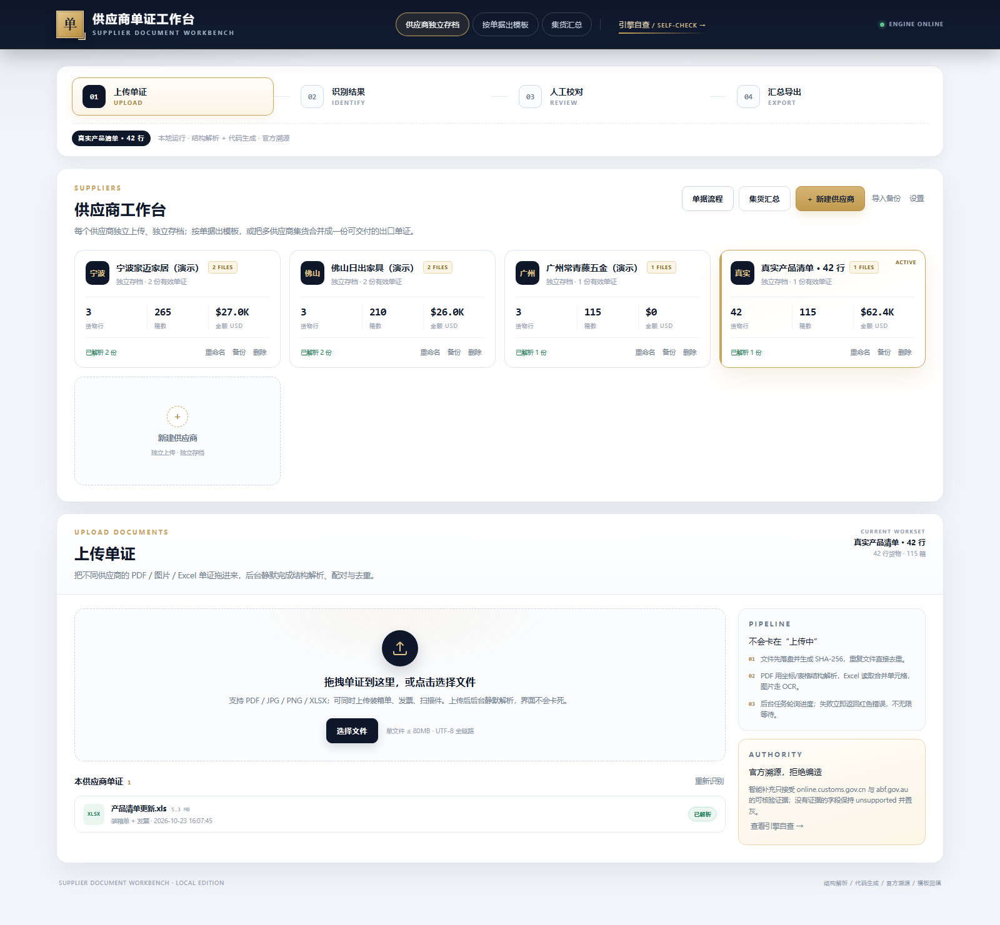

# 供应商单证工作台 / Supplier Document Workbench

把不同供应商的 **PDF / 图片 / Excel** 单证（装箱单、发票、合同、报关资料）解析成统一货行，按供应商去重、合并，再精确回填你的 **5-Sheet 出口单证模板**；带官方溯源、合规门禁、Python 回填脚本和可下载 Excel。



## 1. 当前运行地址

- 本机：<http://127.0.0.1:8000>
- **GitHub 仓库**：<https://github.com/RaymondLEE145/supplier-document-workbench>
- **完整平台（Render，可上传/解析/导出）**：<https://supplier-document-workbench.onrender.com>
- **GitHub Pages 展示页（可分享到微信）**：<https://raymondlee145.github.io/supplier-document-workbench/>
- 完整交互平台需要后端；GitHub Pages 只做静态展示与 HS 查询，不能运行 Python 后端。

## 2. 核心能力

### 2.1 异构单证解析

- PDF：pdfplumber 表格/坐标解析 + PyMuPDF 文本兜底；保留页码、表格、合并单元格、字段坐标。
- 图片：RapidOCR（中英混排）识别表头与行项目；低置信字段标灰。
- XLSX / XLS：openpyxl + xlrd；识别合并单元格、表头行、多级表头、旧版 `.xls`。
- 多供应商：按供应商隔离存档；同一供应商的装箱单 + 发票 + 合同按数量/品名融合；跨供应商汇总为一份可交付单证。
- 去重：内容 SHA-256 重复文件直接忽略；同供应商同货行按数量、箱数、金额合并；冲突显式提示。

### 2.2 5-Sheet 模板回填

- `装箱单` / `发票` / `销售合同` / `报关单` / `申报要素` 五张表。
- 不用 `openpyxl.insert_rows`（会破坏样式/合并/公式），采用「样式快照 → 整表重建 → 合并单元格翻译 → 公式重写」。
- 保留字体、边框、填充、列宽、行高、数字格式、合并区域、页脚、打印区域、fitToPage。
- 动态行数：42 行实测通过；发票/销售合同自动分页、页脚随数据下移。
- 公式：SUM / 跨 Sheet 合计 / 申报要素合计全部重写；Windows 下用 WPS COM 重算并写回缓存值。

### 2.3 中澳协定 → ABF → 中国出口编码为主

智能归类对**全部货行**执行固定顺序：

1. **先看中澳协定（ChAFTA）**：按英文/中文品名、材质匹配 DFAT FTA Portal 的 ChAFTA 税号；命中则读取 2026 优惠税率、MFN、PSR。
2. **ChAFTA 不符合/无条目**：回退 ABF Working Tariff Schedule 3，确认澳洲进口税号/一般税率，不假装存在优惠。
3. **形成澳洲参考税号**：记录 `path=ChAFTA / ABF / AU-reference`，作为平台参考，不直接当作中国出口编码。
4. **中国海关按品名匹配**：用澳洲 HS6 查询 `online.customs.gov.cn` 的 10 位税号，并结合中文品名选择适配行。
5. **展示与导出以中国出口编码为主**：每条 `hs_code` 记录 `au_hs`、`au_path`、ChAFTA rate、PSR、alignment；中国编码冲突时优先中国编码。

本地官方索引：[assets/au_chafta_tariff.json](assets/au_chafta_tariff.json)（9,763 行，来自 DFAT FTA Portal 中国批量下载）。ABF 章节按需抓取并缓存到 `data/abf_chapters/`。

### 2.4 单文件上传：只填对应表，不补造其他单证

如果只上传一类单证，平台只填它对应的 Sheet，其他 Sheet 保持模板空白：

- 只上传**装箱单** → 只填「装箱单」；发票/销售合同/报关单/申报要素不填，不生成金额、合同号、报关信息。
- 只上传**发票** → 只填「发票」；不生成箱单、合同、报关单。
- 只上传**合同** → 只填「销售合同」。
- 只上传**报关单/申报要素** → 只填对应表。
- 装箱单 + 发票 → 只填这两张；不会自动补合同/报关单。
- 中英文品名、HS、已确认的官方溯源信息可补充；缺失的金额、材质、合同号等保持空白，绝不默认 `USD/CIF/一般贸易/纸箱包装` 等值。
- 导出页会显示「本次可填写的单证」，未上传类型明确置灰。

### 2.5 合规门禁

- 只允许补充：`hs_code`、`declaration_elements`、`product_name_en/zh`、`origin_criterion`、`preference_eligible`。
- 每个 supported 值必须有 `source_url`、`retrieved_at`、`matched_evidence`；没有证据的字段保持 `unsupported` 并置灰。
- 申报要素接口返回客户端加密载荷，页面无法取得官方要素表 → **始终 unsupported**，不编造。
- 未确认的 supported 补充、缺失 HS 均阻断导出；申报要素无来源不阻断，但必须勾选确认。

### 2.6 代码生成与导出

- 每次导出生成独立 Python 脚本：`data/scripts/generated_fill_<id>.py`。
- 脚本内嵌 payload，AST 白名单校验，子进程执行。
- 输出文件保留模板样式、公式、合并、分页；服务端 19 项校验 + openpyxl 独立复核。
- 文件名清洗：去掉上传前缀、非法字符，保留供应商/时间戳。

## 3. 快速开始

```bat
cd repo
run_server.bat
```

或：

```powershell
python -m uvicorn app.main:app --host 127.0.0.1 --port 8000
```

打开 <http://127.0.0.1:8000>。

### 依赖

```bash
pip install -r requirements.txt
```

Windows 需要 WPS Office（公式缓存值）；没有 WPS 时导出仍可用，公式缓存值会降级为 warning。

## 4. 目录

```text
repo/
├─ app/
│  ├─ main.py                 FastAPI 路由 / 静态资源 / 上传 / 任务
│  ├─ services/
│  │  ├─ parser.py            PDF/XLSX/XLS/图片结构解析
│  │  ├─ merge.py             供应商内融合 + 跨供应商汇总 + 去重
│  │  ├─ template_engine.py   5-Sheet 样式/合并/公式回填
│  │  ├─ exporter.py          payload / 校验 / WPS 重算
│  │  ├─ compliance.py        官方溯源 / 合规门禁 / 中国关税
│  │  ├─ au_tariff.py         澳洲先行 HS 归类
│  │  ├─ codegen.py           生成独立 Python 回填脚本
│  │  └─ jobs.py              后台任务进度
│  └─ static/                 Vue 3 SPA（index.html / app.js / styles.css）
├─ assets/                    模板 + 官方澳洲税则索引
├─ docs/                      验证报告、截图、导出样例
├─ research/                  官方证据抓取与说明
├─ tests/                     回归与独立校验
├─ testdata/                  可复现测试夹具
├─ Dockerfile / render.yaml   部署
├─ DEPLOY.md                 公网 / Docker / GitHub + Render
└─ requirements.txt
```

## 5. 主要 API

| 方法 | 路径 | 用途 |
|---|---|---|
| GET | `/api/health` | 健康检查 |
| GET | `/api/state` | 供应商/文件/标准模型/合规/导出 |
| POST | `/api/suppliers` | 新建供应商 |
| POST | `/api/upload` | 上传单证（multipart） |
| POST | `/api/identify` | 解析 + 合并 + 标准模型 |
| POST | `/api/compliance/run` | 全量澳洲先行归类 + 溯源 |
| POST | `/api/compliance/confirm` | 批量确认 |
| POST | `/api/compliance/manual` | 人工补充 HS |
| POST | `/api/export` | 生成脚本 + 回填 + 校验 |
| GET | `/api/download/{id}` | 下载 Excel |
| GET | `/api/script/{id}` | 下载生成的 Python 脚本 |
| GET | `/api/self-check` | 引擎自检 |

## 6. 验证摘要

见 [docs/VALIDATION.md](docs/VALIDATION.md)。关键结果：

- 真实浏览器拖拽上传 4 份异构单证（PDF + XLSX）→ 5 行去重，355 箱，USD 39,680。
- 20 张溯源卡片：15 supported / 5 unsupported（申报要素），全部确认后门禁 PASSED。
- 导出 5-Sheet Excel，WPS 重算成功；独立 openpyxl 复核 **98/98**。
- 用户真实 42 行 `.xls`：42 行、115 箱、26,802 件、USD 62,382.63；服务端 19/19（当前工作台更新后合计 USD 54,755.13，再次 19/19）。
- 中澳协定 → ABF → 中国出口编码：11 个挖掘机附件（KUBOTA / 桶 / 松土器 / 螺旋钻 / 货叉等）全部补齐中国 10 位 HS，`missing_hs=0`；当前工作台导出 **19/19 通过**。
- “全部确认并应用” 502 已修复：确认接口改紧凑响应 + 前端乐观更新/自动重试 + bore 隧道；dsh-browser 门禁 `SUPPORTED 44 / CONFIRMED 44 / MISSING HS 0`。
- 42 行光学产品（上一轮）：重新归类/确认后导出 **19/19 通过**，0 失败 0 警告。
- 样例文件：[docs/excavator_11_rows.xlsx](docs/excavator_11_rows.xlsx)、[docs/au_first_42_rows.xlsx](docs/au_first_42_rows.xlsx)、[docs/e2e_verified_export.xlsx](docs/e2e_verified_export.xlsx)。

## 7. 已知限制

- 申报要素：官方接口客户端加密，平台不生成、不猜测；导出时该列保持空白/灰色。
- 澳洲税则：ChAFTA 未列出的行回退 ABF 一般税号；未取得具体 PSR 时只给官方框架，不虚构 CTC/RVC 结论。
- 中国海关 0% 协定税率是中国进口侧优惠，不等同于澳大利亚进口优惠税率；UI/文档已明确区分。
- 当前为本地单用户工作台，无登录鉴权；公网部署前请加访问控制（见 DEPLOY.md）。
- 本机没有 GitHub Token / `git`/`gh`，因此无法替你把仓库 push 到你的 GitHub；已提供源码 ZIP、Docker、Render 蓝图和 CI，拿到授权后一条命令即可推送。
