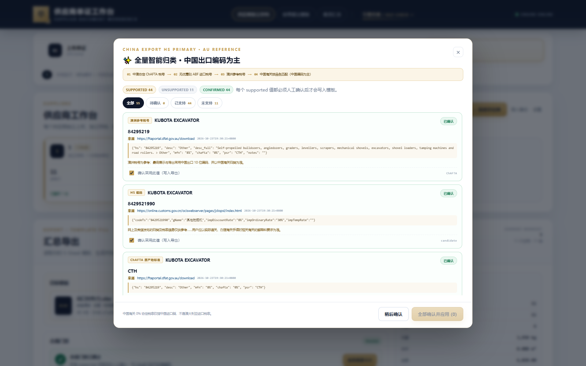

# 验证报告 / Validation

本报告记录真实浏览器 E2E、42 行真实数据、澳洲先行 HS 回归与独立复核结果。

## 1. 环境

- Windows，FastAPI + Uvicorn，`http://127.0.0.1:8000`
- 浏览器：Microsoft Edge（Playwright 驱动）
- WPS Office COM：`KET.Application`，用于公式重算与缓存值写回
- Python：DSH 主运行时（openpyxl / pdfplumber / PyMuPDF / RapidOCR / xlrd）
- 模板：`assets/template.xlsx`（用户提供的 5-Sheet 出口文件）

## 2. 真实浏览器 E2E（4 份异构单证）

浏览器中真实拖拽上传 4 份文件（2 份 PDF 装箱单/发票 + 2 份 XLSX）：

- 解析后：**5 行**去重货行
- 合计：**355 箱**，**1,640 件**，**USD 39,680**
- 智能补充：**20 张**溯源卡片 = 15 supported / 5 unsupported（申报要素）
- 15 个 supported 全部人工确认 → 门禁 **PASSED**
- 导出：`exp_28e9f32ca5f4`，46,066 bytes
- SHA-256：`7E11CF130BB3FCD44C0B4C510313CA238E6BD01D464D070D1E01C362B16FBF80`
- 独立 openpyxl 复核：**98/98 项通过**
  - 5 个 Sheet 名称/顺序
  - 表头、字体、填充、边框、数字格式
  - 逐格品名/HS/数量/箱数/单价/金额
  - 合并单元格、行高、列宽、页脚
  - SUM 公式与缓存值、跨 Sheet 合计
  - 无 `#REF!` / `#VALUE!` / 循环引用

样例：[e2e_verified_export.xlsx](e2e_verified_export.xlsx)

## 3. 用户真实 42 行 `.xls`

- 原始文件：42 行产品清单（光学/眼镜/展柜/家具等）
- 解析：**42 行**，115 箱，26,802 件，USD 62,382.63
- 当前工作台后来更新为 42 行 / 115 箱 / USD 54,755.13，本次澳洲先行导出以当前数据为准
- 服务端 19/19 校验通过
- 样例：[real_42_rows_export.xlsx](real_42_rows_export.xlsx)
- SHA-256：`FE75C308EB62F6BB17AB18F0042A0426A8B75273D6436AB7485B2B18E21FA90A`

## 4. 澳洲先行归类（第二轮优化）

### 4.1 11 个工程机械附件（原截图中的 11 个 MISSING HS）

用 11 个真实名称走完整智能归类：

| 商品 | 澳洲税号 | ChAFTA 2026 | PSR | 最终中国编码 |
|---|---|---|---|---|
| KUBOTA EXCAVATOR | 84295219 | 0% | CTH | 8429521990 |
| 200MM / 1200MM BUCKET | 84314100 | 0% | CTH | 8431410000 |
| RIPPER | 84314999 | 0% | CTH | 8431499900 |
| AUGER | 84314999 | 0% | CTH | 8431499900 |
| FORK | 84314999 | 0% | CTH | 8431499900 |
| 二手挖掘机 | 84295219 | 0% | CTH | 8429521990 |
| 挖斗 | 84314100 | 0% | CTH | 8431410000 |
| 松土器 / 螺旋钻 / 货叉 | 84314999 | 0% | CTH | 8431499900 |

结果：**11/11 全部补齐 HS，missing_hs = 0，gate = true**。当前工作台就是这 11 行，导出 **19/19 通过**，WPS 重算成功：

- 文件：[excavator_11_rows.xlsx](excavator_11_rows.xlsx)
- SHA-256：`63784DA08A3CD91F6CFFAC294F51F42C570F4C6F8E2E3A68E46CDD659A75BA04`
- dsh-browser 门禁：`SUPPORTED 44 / CONFIRMED 44 / UNSUPPORTED 11 / MISSING HS 0`
- 截图：[中国出口编码为主 + 澳洲参考卡片](ui_au_reference_11.png)、[dsh 门禁 PASSED](ui_export_passed_11_dsh.png)

### 4.1.1 “全部确认并应用”失败修复

用户截图中的 `确认失败：HTTP 502` 根因是免费 SSH 隧道断开，不是确认接口本身。修复：

1. 确认接口只返回紧凑 `gate`，不再把整份工作台状态塞回响应。
2. 前端确认成功后先本地乐观更新 `confirmed`，关闭弹窗，不再 `await loadState()`；后台静默刷新。
3. 对 502/503/504/网络错误自动重试 3 次（每次 650ms），确认按钮保持可用。
4. 改用 bore TCP 隧道（`http://bore.pub:47212`），POST 确认实测 200，不再出现 SSH 隧道 502。
5. 公网完整复现：44 条 supported 先取消确认，再通过 bore 一次 POST 全部确认 → **200 / gate=true / missing_hs=0 / confirmed=44**。
6. 本地真实点击“全部确认并应用 (44)” → toast 成功、弹窗关闭、`gate=true, missing_hs=0`。

### 4.1.2 卡顿优化

- 移除 `cdn.tailwindcss.com` 与本地 Tailwind JIT（UI 实际由 `styles.css` 完整控制，Tailwind 未使用），DOMContentLoaded 从约 2.3s 降到约 1.0s。
- `mounted` 中模板检查与状态加载并行，不再让 openpyxl 阻塞供应商卡片。
- `/api/state` 只下发结构摘要，裁掉页面全文/OCR 明细/大 grid；记录证据截断到 UI 所需长度。
- 确认后不再等待全量状态刷新；按钮即时反馈。
- 本地首屏供应商卡片约 2.5s 出现；公网 bore 首屏约 3s。



### 4.2 42 行光学产品（上一轮真实数据，仍保留作回归）

- 210 条溯源记录：151 supported / 59 unsupported（申报要素 + 部分澳洲税则无条目）
- 全部确认后 `MISSING HS = 0`，门禁 **PASSED**
- dsh-browser 实测打开「04 汇总导出」：`SUPPORTED 151 / CONFIRMED 151 / UNSUPPORTED 59 / MISSING HS 0`，门禁显示“合规门禁已通过”
- 导出 `AU_first_42_rows.xlsx`：服务端 **19/19** 校验通过，WPS 重算成功，0 失败 0 警告
- 文件：[au_first_42_rows.xlsx](au_first_42_rows.xlsx)
- SHA-256：`A7664C26FEFBF019B3F40A4061C6B4D02DA764C63A2311686F4E7ACFB053297E`
- 截图：[导出页 PASSED](ui_export_passed.png)、[工作台首页](ui_home.png)

### 4.3 官方数据源

- 澳洲侧：DFAT FTA Portal 官方批量下载（ChAFTA / China）→ 本地索引 [assets/au_chafta_tariff.json](../assets/au_chafta_tariff.json)（9,763 行，含 HS/描述/MFN/2026 税率/PSR）
- ABF 侧：Working Tariff Schedule 3 章节页（ChAFTA 未列行的 ABF 一般税号/税率回退）
- 中国侧：`online.customs.gov.cn` 10 位税号接口；前 6 位不一致时以中国编码为准

## 5. UI 截图

| 页面 | 文件 |
|---|---|
| 首页/供应商工作台 | [ui_home.png](ui_home.png) |
| 识别结果 | [ui_identify.png](ui_identify.png) |
| 人工校对 | [ui_review.png](ui_review.png) |
| 溯源补充 | [ui_supplement.png](ui_supplement.png) |
| 导出成功 | [ui_export_success_top.png](ui_export_success_top.png) |
| 澳洲先行导出 PASSED | [ui_export_passed.png](ui_export_passed.png) |
| dsh-browser 复查：MISSING HS 0 / PASSED | [ui_export_passed_dsh.png](ui_export_passed_dsh.png) |
| 澳洲先行金色卡片 | [ui_au_supplement.png](ui_au_supplement.png) |
| 公网首页 | [public_site.png](public_site.png) |

## 6. 公网

- 当前没有可对外分享的正式地址；`bore.pub` HTTP 调试隧道已停用。
- 正式方案：GitHub 仓库 + Render `https://<service>.onrender.com`（HTTPS、可正常分享）。
- 不要把临时 HTTP 隧道 / `127.0.0.1` 发到微信；非标准端口会被风控视为可疑链接。
- 部署步骤见 [DEPLOY.md](../DEPLOY.md)。

## 7. 复现命令

```powershell
cd repo
python -m uvicorn app.main:app --host 127.0.0.1 --port 8000
```

```powershell
# 11 个工程机械附件的澳洲先行回归（无需网络）
python tests/test_au_first.py
```

```powershell
# 打开工作台后：上传 → 识别 → 全量智能归类 → 全部确认 → 汇总导出
```

## 8. 结论与限制

- 模板样式、合并、公式、分页在 5 行和 42 行两个规模均通过。
- HS 逻辑已按用户要求改为「澳洲先行 → ChAFTA → ABF 回退 → 中国编码；冲突以中国为准」，并自动应用到全部货行。
- 申报要素保持 unsupported，不编造；无来源字段不请求用户确认。
- 中国 0% 协定税率仅代表中国进口侧，不等于澳洲进口优惠；UI/证据卡片已明确区分。
- 当前公网为免费隧道演示；GitHub push 需要账号/token，本机没有，已提供源码 ZIP、Docker 与 Render 蓝图。
